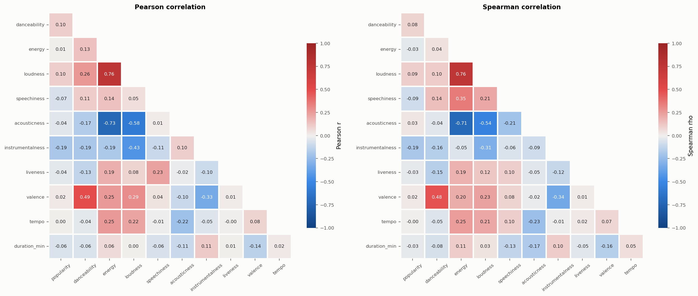
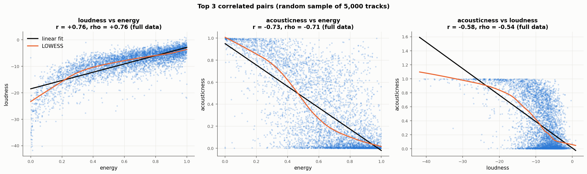
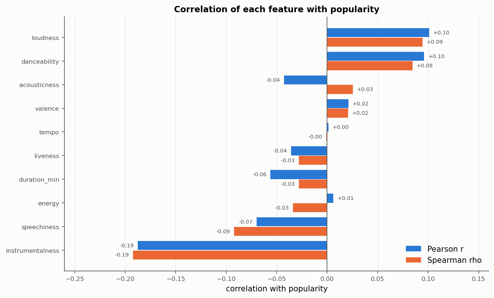
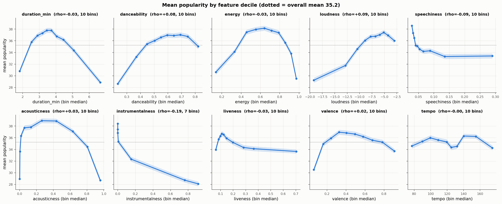
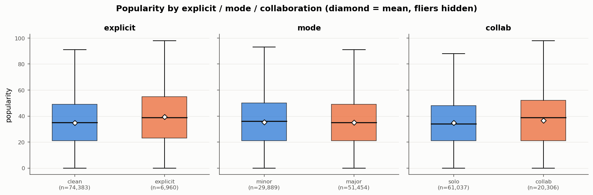
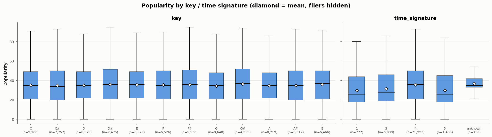

# Spotify Tracks: Data Cleaning & EDA (BT4211 Final Project)

This is the data cleaning and exploratory analysis of 114,000 Spotify tracks across 114 genres. The goal is to understand which track attributes are associated with **popularity** (0–100) before modelling.
After cleaning, the analysis uses **81,343 unique songs**. Everything below comes from [`bt4211-project.ipynb`](bt4211-project.ipynb), which has the full code, tables and every chart.

## Key Findings

- **Audio features are weak linear predictors of popularity.** No feature has |correlation| above 0.19 with popularity. The strongest is `instrumentalness` (Spearman ρ = −0.19), followed by `loudness` (+0.09) and `danceability` (+0.08).
- **Several relationships rise and then fall.** When popularity is averaged by feature decile, it peaks for mid-length tracks (~3–4 min, about 38) and drops to about 29 for the longest decile. `energy`, `danceability` and `valence` show the same rise-then-fall shape, which a single correlation coefficient hides.
- **Three features measure one "intensity" axis:** energy–loudness (r = +0.76), energy–acousticness (r = −0.73) and loudness–acousticness (r = −0.58). Even so, every VIF is below 5 (max: energy 4.31), so multicollinearity is moderate.
- **Explicit tracks and collaborations score slightly higher.** Explicit tracks average 39.4 vs 34.9 for clean ones (rank-biserial 0.12), and collaborations have a median of 39 vs 34 for solo tracks. Both differences are significant (p < 0.001) but small. Mode has no effect (p = 0.22).
- **Genre matters far more than any single audio feature.** Mean popularity by genre ranges from 2.2 (iranian) to 59.3 (pop-film).

## Dataset

| | |
|---|---|
| File | `spotify_dataset.csv` (114,000 rows × 21 columns) |
| Target | `popularity` (integer, 0–100) |
| Audio features | danceability, energy, loudness, speechiness, acousticness, instrumentalness, liveness, valence, tempo, duration_ms |
| Categorical | explicit, mode, key, time_signature, track_genre (114 genres, ~1,000 rows each) |
| Identifiers | track_id, artists, album_name, track_name |

## Data Cleaning

The audit showed that one song often appears in several rows: once per genre label, and sometimes again as a separate release. Cleaning therefore produces two tables:
- **`tracks`**: 81,343 rows, one per unique song. Used for most of the analysis.
- **`genre_df`**: 113,549 rows, one per track × genre. Used for genre-level analysis.

| # | Issue | Action | Rows affected |
|---|---|---|---|
| 1 | `Unnamed: 0` is an exported row index | Drop column | all (column) |
| 2 | Missing artist / album / track name **and** `duration_ms = 0` | Drop row | 1 |
| 3 | Rows identical except `popularity` (same track_id + genre) | Drop duplicate | 450 |
| 4 | Same `track_id` with conflicting popularity | Keep max | 720 track_ids |
| 5 | `tempo = 0` (mostly sleep / white-noise audio) | Set to NaN, flag `non_music` | 157 |
| 6 | `time_signature = 0` (not a real meter) | Set to NaN | 163 |
| 7 | Leading / trailing whitespace in text | Strip | 8 cells |
| 8 | Same track listed under several genres | Collapse to one row per track, genres kept as a list | 23,809 rows merged |
| 9 | Same song (artists + track_name) released under different IDs | Keep most popular release | 8,397 |

Outliers were **not removed**. Most values flagged by the IQR rule (e.g. high speechiness in comedy, low loudness in classical) are normal within their own genre. See section E6 of the notebook.

## Correlation Analysis

**Pearson and Spearman matrices.** Only three pairs pass |r| > 0.5: energy–loudness, energy–acousticness and loudness–acousticness. Pearson and Spearman mostly agree. A larger gap, as for speechiness–energy (Spearman ρ 0.35 vs Pearson r 0.14), points to a skewed or non-linear relationship.



**Top 3 pairs (5,000-track sample).** The curved trend lines (LOWESS) bend away from the straight fits. For example, loudness climbs quickly at low energy and then levels off. A linear model will under-fit these extremes.



**Correlation with popularity.** Every feature is weakly related to popularity. Instrumentalness is the strongest, and it is negative (−0.19). For acousticness, Pearson and Spearman even disagree on the sign (−0.04 vs +0.03).



**Mean popularity by decile.** Splitting each feature into deciles shows rise-then-fall patterns that the correlations miss. Mid-range duration, energy, danceability, acousticness and valence are the most popular. Across the deciles, mean popularity varies by up to 10.2 points (acousticness).



**Explicit, mode and collaboration.** Explicit tracks (+4.6 mean) and collaborations (+1.8 mean) are a little more popular. Major vs minor mode makes no difference.



**Key and time signature.** Key is statistically significant but negligible in practice: means range only from 34.5 to 36.4 (ε² = 0.0007). 4/4 tracks score higher than other meters, but the effect is still small (ε² = 0.006).



**Multicollinearity (VIF).**

| Feature | energy | loudness | acousticness | valence | danceability | instrumentalness | others |
|---|---|---|---|---|---|---|---|
| VIF | 4.31 | 3.29 | 2.44 | 1.59 | 1.51 | 1.47 | ≤ 1.17 |

Every VIF is below 5, and dropping `energy` lowers the highest VIF to 2.04 (loudness). Dropping `energy` is only worth it if a linear model's coefficients need to be easy to interpret.

The other EDA charts are in [`figures/`](figures/) with full commentary in the notebook: distributions, genre profiles, explicit share by genre, genre overlaps, artists and outliers.

## Limitations

- **Sampling:** genres were sampled at about 1,000 tracks each, so genre shares do not reflect Spotify's real catalogue.
- **Zero popularity:** 4,758 songs (5.8%) have popularity 0, and they cluster in a few genres, which pulls those genres' means down. These zeros may reflect how the data was collected rather than real unpopularity.
- **Single snapshot:** popularity is a one-time value with no time dimension, so trends over time can't be studied.
- **Associations, not causes:** the correlations and group differences are not causal effects. Part of the explicit effect, for example, comes from genre mix.
- **Song matching:** de-duplication matches songs on exact `artists` + `track_name`, so variants with different titles (e.g. "– Remastered") are kept as separate songs.

## Next Steps

- **Model choice:** use tree-based models (or splines) to capture the rise-then-fall relationships. Rank- or log-transform the skewed features for linear baselines.
- **Genre and artist features:** encode `genres` as multi-label (multi-hot) features. Add an artist-level feature, such as the mean popularity of the artist's other tracks, computed out-of-fold to avoid leakage.
- **Zero popularity:** decide how to treat popularity-0 tracks, either as a separate class or by excluding them, and compare model results both ways.
- **Robustness check:** control for genre when testing the explicit and collaboration effects.

## How to Run

```bash
git clone https://github.com/caixiaoqijessica/bt4211-final-project-spotify-dataset.git
cd bt4211-final-project-spotify-dataset
pip install -r requirements.txt
jupyter notebook bt4211-project.ipynb      # run all cells
# or headless:
jupyter nbconvert --to notebook --execute --inplace bt4211-project.ipynb
```

Run the notebook from the repo root so it can find `spotify_dataset.csv`. A full run regenerates every PNG in `figures/`. Tested with Python 3.10.
